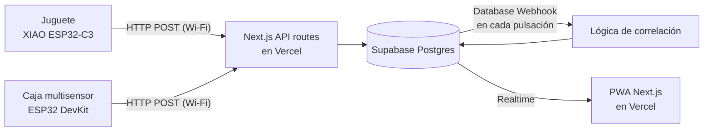

# Tuli Toy: Not A Regular Toy — Contexto del proyecto

Contexto consolidado al 15 de octubre de 2026 a partir de la planeación, el reporte del proyecto y las decisiones técnicas tomadas hasta ahora. El repositorio, los issues y el tablero de GitHub Projects son la fuente más reciente: si algo de este archivo contradice lo que hay en el repo, gana el repo, y hay que señalar la diferencia en lugar de asumir cuál es la correcta.

## Qué es Tuli

Tuli es un sistema IoT de dos dispositivos y una PWA que identifica qué condiciones del entorno preceden los momentos de nerviosismo, ansiedad o miedo de un niño. Está dirigido a padres, docentes y especialistas que necesitan datos objetivos para detectar esos detonantes (triggers).

- **Juguete tipo fidget.** El niño lo presiona cuando siente nerviosismo, ansiedad o miedo. Solo registra la marca de tiempo de cada pulsación.
- **Caja multisensor.** Se deja en la habitación a monitorear (salón, recámara, estancia, guardería) y registra ruido (dB), iluminación (lux), temperatura y humedad cada 5 a 10 segundos, con marca de tiempo.
- **PWA.** Cruza las pulsaciones del juguete con las lecturas de la caja y muestra qué condición ambiental se repite antes de cada evento.

La primera versión es para un solo niño. La arquitectura debe permitir escalar a un salón completo: un juguete por alumno y una caja por espacio.

Tuli no diagnostica ni trata nada; solo muestra coincidencias entre condiciones y eventos. Cualquier texto de la interfaz debe respetar eso.

### Nombres

El nombre actual es **Tuli** ("Tuli Toy: Not A Regular Toy"). Antes se llamó **Tilo**, y al inicio **Not-A-Regular-Toy** o **Not-just-a-toy**. El tablero de GitHub Projects se creó como "Not-a-Regular-Toy" y en el prototipo hay identificadores con `tilo-` (por ejemplo `tilo-toy-01`). Todos se refieren al mismo proyecto.

## Equipo

| Integrante | Área | Responsabilidades |
| --- | --- | --- |
| Alex (Alejandro Castro Martínez) | IoT y hardware; Scrum Master rotativo | Circuitos y firmware de ambos ESP32, sincronización de hora, prototipos, administración del repo y del tablero |
| Jac | Diseño y frontend; Product Owner | Orden del backlog, identidad visual, wireframes (Figma), interfaz de la PWA, diseño de carcasas |
| Lucy | Backend y datos; Scrum Master rotativo | Modelo de datos en Supabase, API de ingesta, relación entre eventos y lecturas, consultas de análisis |

Investigación, integración, pruebas y documentación se reparten en cada Sprint Planning.

## Metodología y flujo de trabajo

Scrum con sprints de una semana que coinciden con la entrega semanal de avances del curso. Sprint Planning de 30 min al inicio de la semana, 2 o 3 dailies breves por semana, Sprint Review en la entrega al docente y Retrospective de 15 min después.

**Definition of Done:** la tarea cumple su criterio de aceptación, está integrada en `main` o documentada, la revisó otro integrante y se puede demostrar en la revisión del sprint.

### GitHub Projects

- Plantilla "Iterative development", iteraciones de 1 semana, campo personalizado **Área** (investigación, hardware, backend, frontend, gestión).
- Workflows: auto-add de issues al tablero (`is:issue`), item added → Backlog, item closed → Done, PR merged → Done.
- Cada elemento del backlog es un issue con objetivo y criterio de aceptación. La evidencia (código, entrevistas, investigación) se liga al issue.

### Convenciones del repo (ver también `CONTRIBUTING.md`)

- Una rama por issue, creada desde el issue (Development → Create a branch). Nombres tipo `7-entrevistas-con-especialistas` o `docs/7-entrevistas`.
- Los commits mencionan el issue: `Agrega entrevista con terapeuta #7`.
- El PR lleva `Closes #N` en la descripción. Las palabras clave que cierran issues solo funcionan en inglés: `closes`, `fixes`, `resolves`.
- Revisión de otro integrante y **Squash and merge**. Las ramas se borran solas al hacer merge.
- `main` protegida con PR y al menos 1 aprobación (requiere GitHub Pro vía Student Developer Pack en repos privados).
- Plantilla de issues en `.github/ISSUE_TEMPLATE/` con secciones: Objetivo, Criterio de terminado (checklist) y Notas / dependencias. Issues en blanco deshabilitados con `config.yml`.
- La documentación vive en `/docs` (por ejemplo `docs/investigacion/`). La wiki está desactivada.
- Datos sensibles (grabaciones o datos personales de entrevistas) no van en el repo.

## Objetivos

**General:** desarrollar durante el cuatrimestre un prototipo funcional del sistema (caja multisensor, juguete fidget y PWA) que registre las condiciones del ambiente y los momentos de malestar de un niño, para identificar qué condiciones coinciden con mayor frecuencia con esos momentos.

| No. | Objetivo específico | Indicador |
| --- | --- | --- |
| OE1 | Identificar necesidades de información mediante entrevistas y fuentes secundarias | ≥ 3 entrevistas a especialistas, docentes o familias y ≥ 5 fuentes secundarias |
| OE2 | Definir la arquitectura y el formato de datos entre dispositivos y base de datos | Contrato de datos documentado y aprobado por el equipo antes de la integración |
| OE3 | Construir la caja multisensor (sonido, luz, temperatura, humedad) | Una lectura cada 5 a 10 s enviada con fecha y hora |
| OE4 | Construir el juguete que registre cada pulsación | Cada pulsación enviada con fecha y hora |
| OE5 | Implementar base de datos y backend en Supabase | Cada evento queda relacionado con las lecturas de los minutos previos |
| OE6 | Desarrollar la PWA de consulta | Vistas de historial de eventos, condiciones previas a cada evento y condiciones más frecuentes |
| OE7 | Diseñar y fabricar las carcasas | Impresas en 3D, sin piezas pequeñas desprendibles ni bordes filosos |
| OE8 | Validar el sistema completo con una prueba controlada | ≥ 1 día de registro continuo y 100 % de las pulsaciones visibles en la PWA |

## Arquitectura



| Capa | Tecnología | Uso |
| --- | --- | --- |
| PWA y API | Next.js (App Router), React, TypeScript | Interfaz y rutas de API que reciben los datos de los dispositivos |
| Datos | Supabase: Postgres, Auth, Database Webhooks, Realtime | Almacenamiento, autenticación, disparo del análisis por evento y actualización en vivo |
| Despliegue | Vercel | PWA y API (serverless) |
| Firmware | Arduino IDE o PlatformIO | ESP32 y ESP32-C3 |
| Diseño | Figma; modelado 3D y laminador | Wireframes y carcasas |

Decisiones de arquitectura ya tomadas: monolito modular (se descartaron microservicios); Next.js + Supabase en lugar de Angular + Firebase. El análisis se describe en SQL (JOINs, GROUP BY, funciones de ventana), no con pipelines de MongoDB.

## Hardware

### Juguete

- Seeed XIAO ESP32-C3 sin protoboard, batería LiPo 3.7 V con protección, botón táctil de 12 mm, interruptor de apagado y LED de confirmación.
- Botón en **GPIO3 (D1)**: en el ESP32-C3 solo GPIO0 a GPIO5 pueden despertar la placa del deep sleep.
- La marca de tiempo se calcula con **NTP + `millis()` transcurridos desde la pulsación**, para que la demora en conectarse al Wi-Fi no altere la hora del evento.
- Periodo de espera (cooldown) tras cada pulsación para no registrar el mismo evento dos veces.
- La batería queda totalmente encerrada y la carcasa se cierra con tornillos (seguridad infantil).

### Caja multisensor (lista de materiales del reporte)

- ESP32 DevKit V1, sensor de temperatura y humedad SHT31 o AHT20, luz BH1750, micrófono I²S INMP441, RTC DS3231 y eliminador USB de 5 V.
- Se eligió INMP441 en lugar de KY-038/KY-037 porque los KY solo detectan si hay ruido, no el nivel en dB.
- El sensor de temperatura y humedad va separado del ESP32, porque el calor del ESP32 con Wi-Fi altera las lecturas.
- Con Wi-Fi activo, las lecturas analógicas deben ir en pines **ADC1 (GPIO32 a 39)**; ADC2 no funciona.

### Propuesta de mejora de sensores (13 oct, sin confirmar)

Después del prototipo se evaluó un kit más profesional para la caja final. Revisar en los issues si ya se adoptó y qué partes:

- Base: sonda SHT41/SHT45 (temperatura y humedad, I²C), BH1750 con domo difusor, DFRobot SEN0232 (dBA calibrado, analógico en GPIO34/35, `dB = voltaje × 50`) y SCD41 (CO₂ real).
- Opcionales: radar mmWave HLK-LD2410C (ocupación y movimiento sin cámara, UART en GPIO16/17), AS7341 (parpadeo y color de la luz) y SGP41 (índice de VOC).
- Muestreo de sonido continuo (por ejemplo cada 100 ms) y envío de **promedio y pico** por ventana, porque un portazo o un grito duran menos de un segundo y se pierden con una lectura cada 5 a 10 s. Lo mismo aplica a cambios bruscos de luz.
- Carcasa de dos zonas (ESP32 separado de los sensores, paso de cables sellado), placa perforada con conectores JST o Qwiic/STEMMA QT en lugar de protoboard, postes para tornillos M2.5. Tamaño estimado 14 × 10 × 6 cm.

Si se adopta, cambia el esquema de lecturas (más columnas y valores promedio/pico) y el contrato de datos de OE2.

## Prototipo rápido con Arduino UNO (funcionó)

Sirvió para validar el flujo de datos antes de tener los ESP32. Un botón simula el juguete; una fotorresistencia y un termistor simulan la caja; el micrófono de la laptop mide el ruido.

```
Botón y sensores → Arduino UNO → USB serie (9600 baud) → bridge.mjs (Node) → Supabase REST → Postgres
Micrófono de la laptop → mic.py (Python) → Supabase REST → sensor_readings.noise_dbfs
```

- El UNO imprime líneas JSON por serie: `{"type":"press"}` y `{"type":"reading","light":…,"temp_c":…}`.
- `bridge.mjs` asigna la marca de tiempo (el UNO no tiene reloj) e inserta en Supabase.
- Variables en `.env`: `SUPABASE_URL`, `SUPABASE_KEY` (publishable/anon), `SERIAL_PORT`, `TOY_ID` (`tilo-toy-01`), `SENSOR_ID` (`tilo-box-01`).

Esquema del prototipo:

```sql
create table public.toy_events (
  id bigint generated always as identity primary key,
  device_id text not null,
  event text not null default 'press',
  pressed_at timestamptz not null default now()
);

create table public.sensor_readings (
  id bigint generated always as identity primary key,
  device_id text not null,
  measured_at timestamptz not null default now(),
  light_raw int,
  temp_c real,
  noise_dbfs real
);
-- RLS activado con políticas de INSERT para anon (solo para el prototipo)
```

Consulta de correlación usada para probar (lecturas de los 30 s previos a cada pulsación):

```sql
select e.pressed_at, r.device_id, r.measured_at, r.light_raw, r.temp_c, r.noise_dbfs
from toy_events e
join sensor_readings r
  on r.measured_at between e.pressed_at - interval '30 seconds' and e.pressed_at
order by e.pressed_at desc, r.measured_at;
```

Este esquema es un punto de partida, no el definitivo: le faltan humedad, lux reales, niño/salón/dispositivo como entidades y la relación con usuarios para RLS.

## Datos y privacidad (reglas del proyecto)

Los momentos de ansiedad de un niño pueden revelar su estado de salud, así que se tratan como **datos personales sensibles** (LFPDPPP, México). Requieren consentimiento expreso y por escrito del padre, madre o tutor, aviso de privacidad, minimización y medidas de seguridad.

- Durante el desarrollo no se usan datos reales de niños: solo datos simulados o de los integrantes.
- El micrófono calcula solo el nivel en dB en el dispositivo; nunca graba ni envía audio. No se usan cámaras ni mediciones del cuerpo.
- Supabase con autenticación y RLS: cada familia o docente solo ve a los niños a su cargo.
- Las políticas `anon` de insert del prototipo no deben pasar a producción. Nunca usar la `service_role`/secret key en firmware ni en el navegador, y nunca subir `.env` al repo.
- Pendiente en el backlog: borrador del aviso de privacidad y del formato de consentimiento para padres y tutores.

## Cronograma

15 semanas, del 31 de agosto al 11 de diciembre de 2026, un sprint por semana.

- Concluidos: propuesta, planeación y diseño del estudio de mercado.
- En curso: entrevistas a expertos (guía y registros en el repo).
- Desde el 19 de octubre: construcción de firmware y backend, en paralelo con PWA y carcasas.
- 23 de noviembre: integración de las tres áreas.
- Dos semanas finales: pruebas y cierre.

Presupuesto del primer prototipo completo: $1,722 a $3,177 MXN sin herramientas (Supabase, Vercel y GitHub en planes gratuitos o de estudiante).

## Estado de entregables (al 9 de octubre, actualizado con el 13)

| Entregable | Estado |
| --- | --- |
| Propuesta y arquitectura | Terminado |
| Documento de planeación y portafolio de evidencias | Terminado (fuera del repo) |
| Diseño del estudio de mercado | Terminado |
| Entrevistas a expertos | En curso |
| Selección de hardware y lista de compras | Terminado (checklist en un issue); revisión de sensores de la caja en evaluación |
| Repo, tablero, plantillas y `CONTRIBUTING.md` | Terminado |
| Prototipo rápido con Arduino UNO | Funcionó |
| Firmware de los ESP32, PWA y carcasas | Pendiente |

## Puntos abiertos que conviene verificar en el repo

1. Qué sensores lleva la caja final: la lista del reporte (SHT31/AHT20, BH1750, INMP441, DS3231) o la propuesta del 13 de octubre (SHT41, BH1750 con domo, SEN0232, SCD41 y opcionales).
2. El contrato de datos definitivo (OE2): tablas, columnas, unidades y si se envían promedio y pico.
3. Si los dispositivos insertan a través de las API routes de Next.js (arquitectura objetivo) o directo a Supabase REST como el prototipo.
4. La ventana de correlación: el prototipo usó 30 s; el objetivo habla de "los minutos previos".
5. La sincronización NTP es una dependencia oculta entre ambos dispositivos: si sus relojes no coinciden, la correlación falla.
6. Modelo de usuarios, niños y salones para RLS y para escalar a varios juguetes por salón.
7. Para Iteración 2 se redactaron alrededor de 13 ideas de issues (investigación, hardware, backend, frontend, gestión). Revisar cuáles existen ya como issues.

## Cómo trabajar en este repo

- Antes de proponer trabajo, revisar los issues abiertos y el tablero, y ligar cada cambio a un issue.
- Seguir las convenciones de ramas, commits y PR de arriba y de `CONTRIBUTING.md`.
- Responder en español.
- En hardware y en Git/GitHub, explicar paso a paso y con verificaciones en cada etapa; el equipo tiene poca experiencia más allá del protoboard y de subir archivos al repo.
- Si algo en el código, los issues o este archivo se contradice, señalarlo y preguntar en lugar de elegir en silencio.
